# 底板硬件 Review

审查日期：2026-11-07。对象：[原理图](../SCH_底板_2026-11-07.pdf)、[PCB](../PCB_底板_2026-11-07.pdf)、[BOM](../BOM_底板_2026-11-07.xlsx)，为本次重新上传、加入 INA226 的版本。

已按用户确认关闭电池通路负载、U2 背面插接方向、3.5mm 转同轴问题；Type-C 输入能力识别按项目决定不做。本次基于 PDF 和器件资料，不代替源工程 ERC/DRC 或实测；未覆铜的地焊盘不计作漏连。

## 原理图逐块核对

### 第 1 页：Type-C 输入

CC1/CC2 各接 5.1kΩ 下拉，供电接口接法正常。D1 保留 SMF6.0CA 用于瞬态抑制，不保证将 VIN 限制在 5.5V 以下；按项目决定不增加输入过压断开。

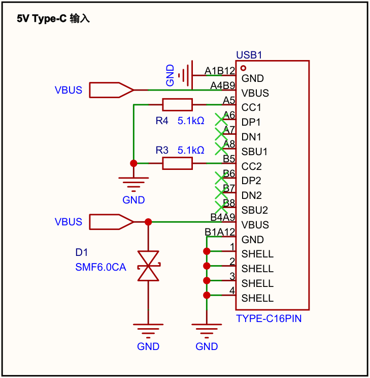

### 第 1 页：电池充放电

主通路为 CN1 → U9 → R20（10mΩ）→ VBAT，充放电均经过采样电阻；电池侧接 IN+，系统侧接 IN−，放电为正、充电为负。IP5306 的 R2（0.5Ω）保留正确；U9 仅断电池，USB 接入时仍可能供电。

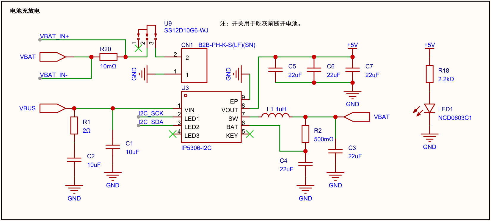

### 第 1 页：机械按键

按下接地；软件配置输入上拉与消抖。

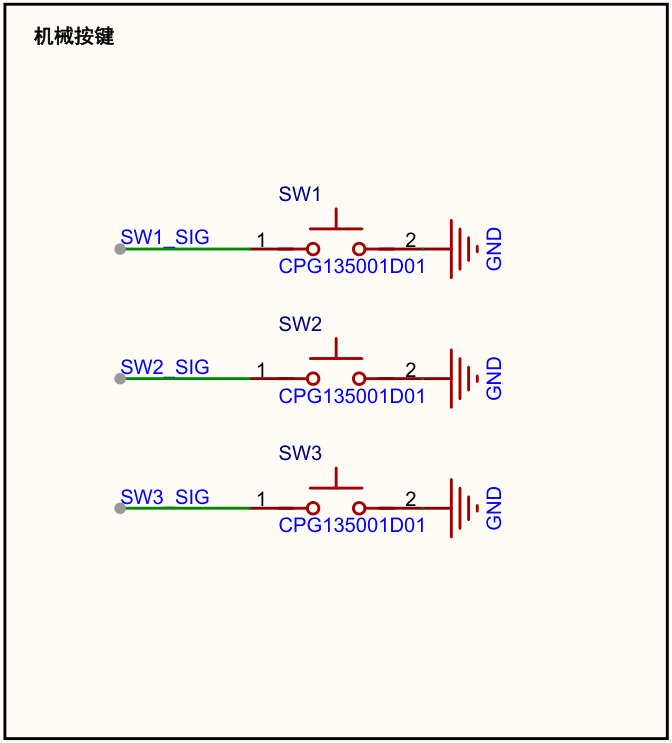

### 第 1 页：USB Host

U6：1=NC、2=D−、3=D+、4=GND，与核心板 H5 对应。

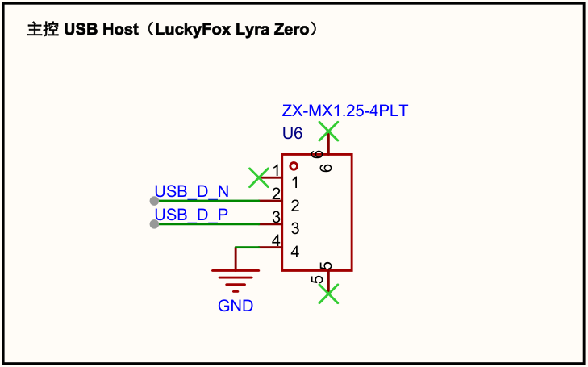

### 第 1 页：40Pin 与屏幕 FPC

沿用已确认的 U2 奇偶互换映射。X1：1/12=GND、13=3.3V（经 R21）、14=5V；信号映射已同步至 [Pinout.md](../Pinout.md)。X1 与鸿讯模块接口需按信号转接；装配时核对排线接触面。

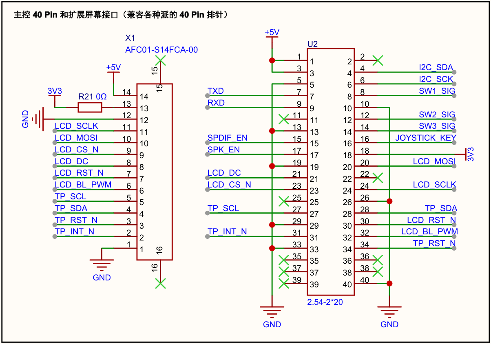

### 第 1 页：摇杆与 ADC

AIN0/1 接两轴，AIN2/3 均接地；摇杆与 ADC 同用 3.3V，不存在原电池分压的持续反供来源。ADS1015=0x48、INA226=0x40、IP5306=0x75，无地址冲突。I²C2 沿用核心板上拉，摇杆量程用 ±4.096V。

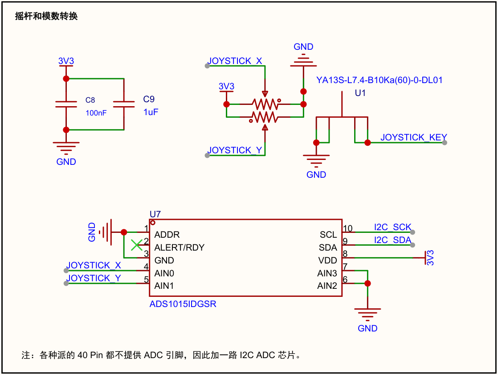

### 第 1 页：调试串口

H1：1=核心板 RX、2=TX、3=GND；使用 3.3V TTL，外接收发交叉。

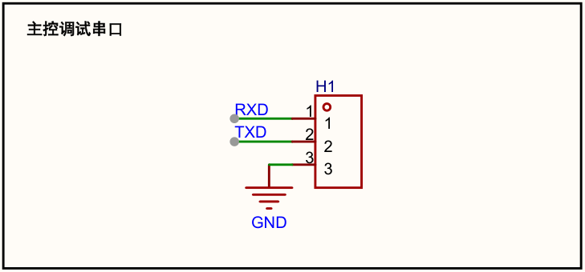

### 第 1 页：INA226 电压／电流检测

U10：1/2/7=GND、3=NC、4/5=SDA/SCL、6=3.3V、9/10=IN−/IN+，接法正确。C37=100nF 为供电去耦；R19=100Ω 与 C38=100nF 滤波 VBUS。INA226 允许自身掉电时测量端仍有电压，无需另加 ADC 隔离。[TI 手册第 3、10、31 页](https://www.ti.com/lit/ds/symlink/ina226.pdf)。

**VBUS 当前取 R20 系统侧 VBAT。** 若要得到 U9 后、R20 电池侧电压，可改接 VBAT_IN+，或软件近似补偿 `V电池侧 = V读数 + I×0.01Ω`（I 单位 A，放电为正）。现接法不是漏连或接反。

软件可设 `0x00=0x4527`、`0x05=0x0800`；电流 `int16(0x04)×0.25mA`，电压 `0x02×1.25mV`。重新上电需初始化；3.3V 关闭后不测量、不累计充电量。

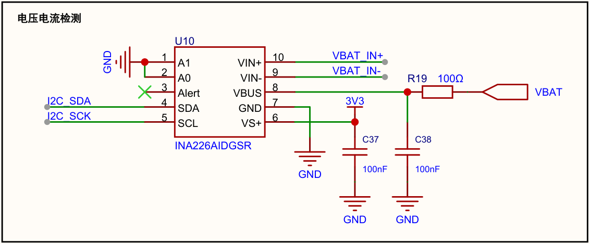

### 第 2 页：USB 声卡

CM108B 供电、内部稳压去耦、模式脚、USB 极性及左右声道接法正常。器件端串联匹配电阻可预留，样板验证反复枚举与录放音。

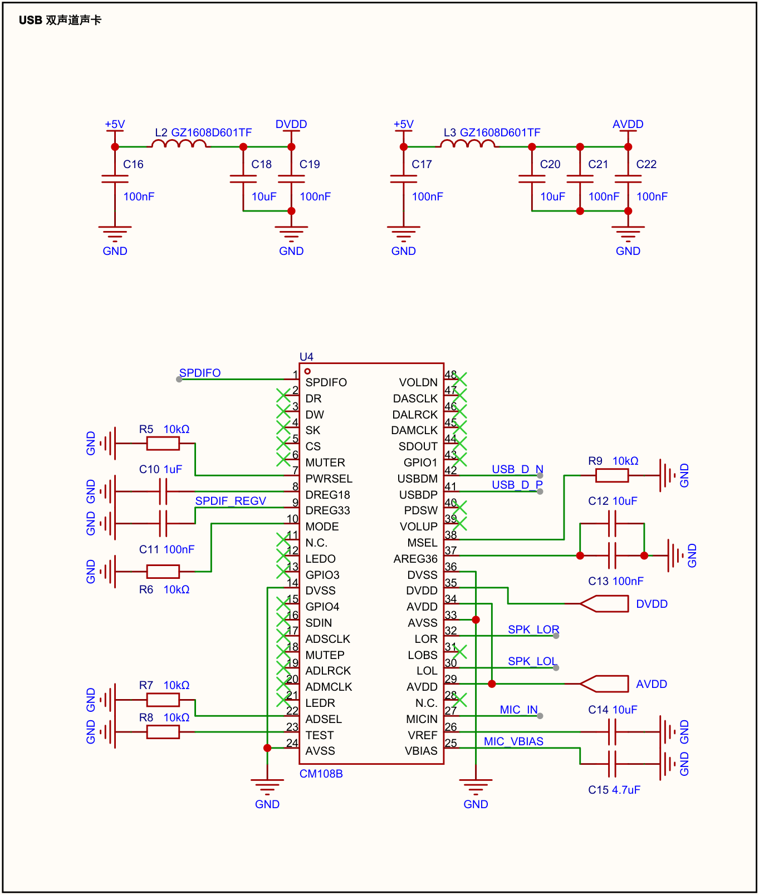

### 第 2 页：S/PDIF

缓冲器高有效使能、默认下拉正常。249Ω/110Ω 网络等效约 76Ω，接 75Ω 负载时理想幅度约 0.50Vpp；同轴转接已确认。标题建议简化为“3.5mm 同轴 S/PDIF 输出”。

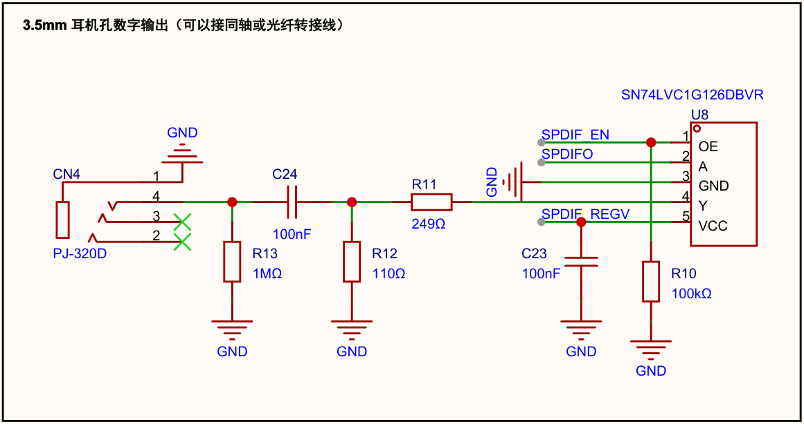

### 第 2 页：扬声器

两路均为 BTL 输出，负端不可共地。“8Ω 2W”是扬声器额定规格，不代表实际输出功率。

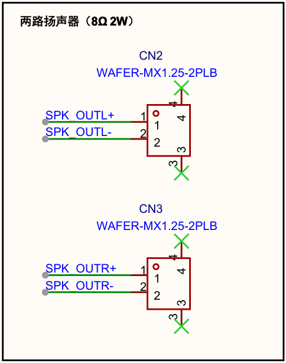

### 第 2 页：功放

PAM8403 供电、去耦及使能接法正常，R17 保证默认关断；本 BOM 萨科微版本支持 3.3V 控制。82kΩ/100nF 输入网络需实测音量、低频和削顶。

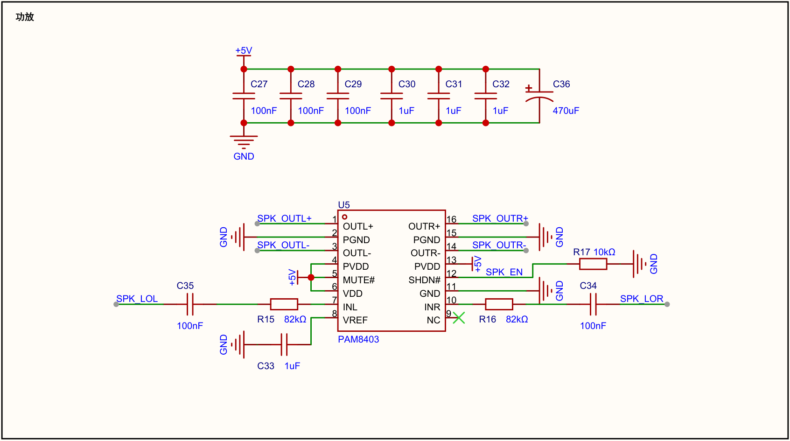

### 第 2 页：麦克风

偏置、隔直和高频滤波接法正常；样板检查底噪、增益与扬声器回授。

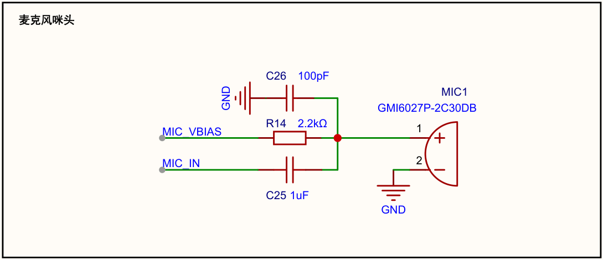

## PCB 与 BOM

已查看正反面布线，背面图为镜像；功放、麦克风与电源分区基本合理。覆铜后重点完成：

- U3 EP 接地散热、输入／输出电容的短回流及上下层地连接。
- USB、SPI 参考地连续；功放输出及 DC-DC 回流避开 MIC_IN、VBAT_IN+/−。
- 地铜孤岛、细颈、板边间距、未连接及完整 DRC；当前 PDF 无法确认通过。

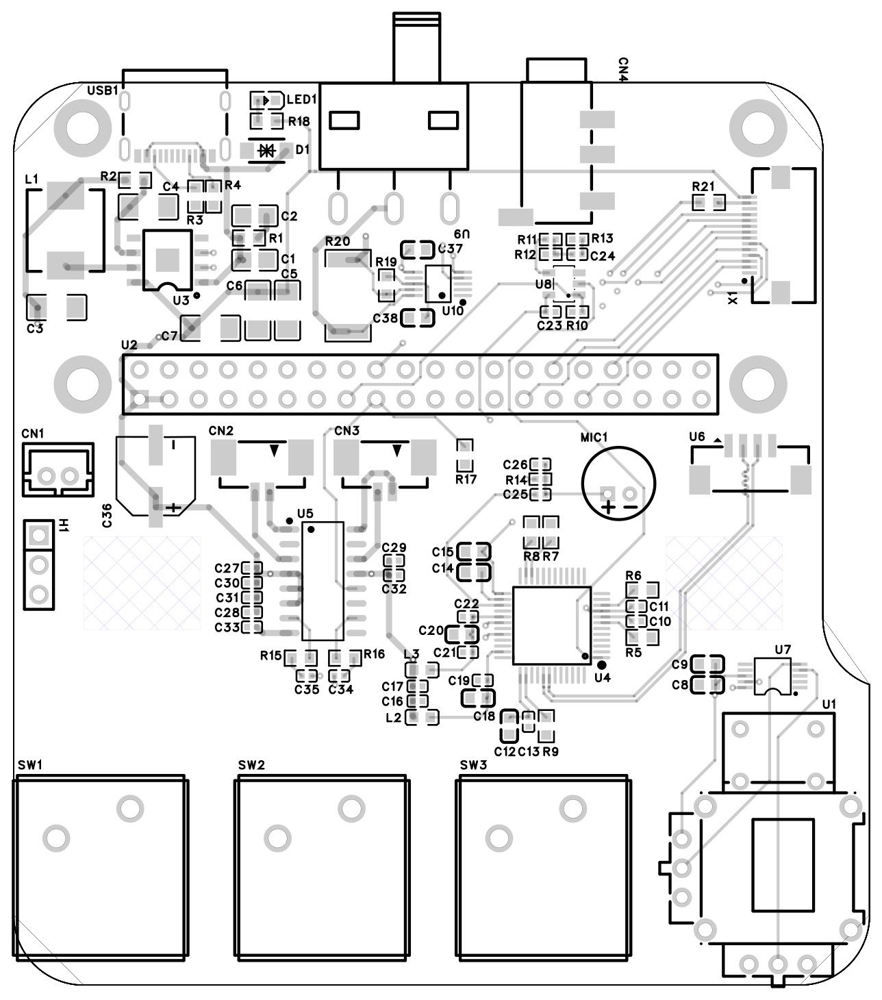

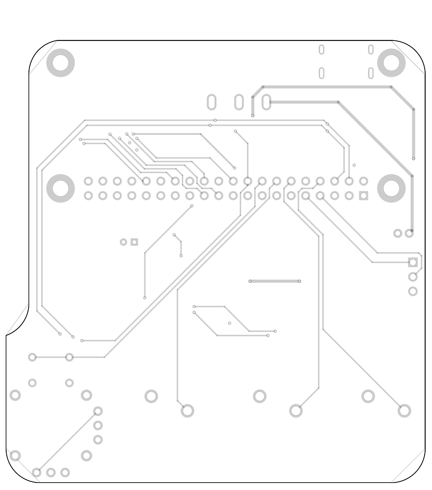

R20 两端已分别从焊盘引出取样线，未见明显绕过采样电阻的并联走线；U10 去耦与测量滤波靠近芯片。保持 Kelvin 取样，勿让后续覆铜短接 R20 两个网络；样板用已知正／反向电流核对零点、比例和符号。

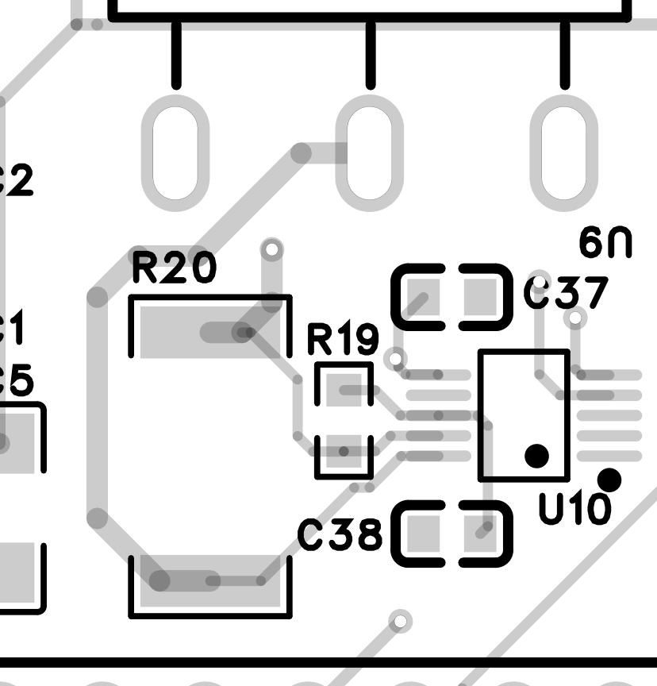

BOM 共 **46 组、85 个位号**，数量一致、无重复，新增 U10、C38 及变更后的 R19/R20 均已列入；R20 后续换料按用户确认记录。其余模块按仓库 [datasheets](../references/datasheets/)、[参考原理图](../references/schematics/)及[屏幕手册](../references/manuals/2.8寸SPI接口模块28005数据手册（鸿讯电子）.pdf)核对。

样板优先验证：INA226 电压／双向电流及温漂 → 电池冷启动／充电器插拔 → SPI 屏与触摸 → USB 音频／同轴输出。
