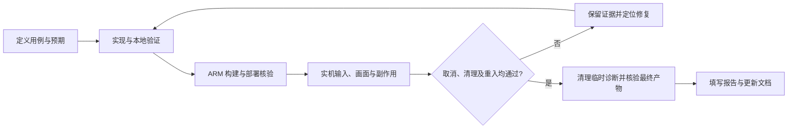

# 实机闭环测试

本流程用于把“代码能编译”推进到“开发板上的真实行为已经验证”。默认在开发主机的 `src/` 下执行命令；明确标注的 SSH 命令在板端执行。开发板地址按现场实际替换。



## 1. 先定义用例与证据

开始实现前，复制 [报告模板](templates/board-test-report.md)，为每条关键路径写下输入、预期画面、实际副作用、取消后的资源状态及证据。组件最少覆盖以下适用项：

| 场景 | 需要观察的结果 |
|---|---|
| 首次进入、缺配置、设备缺失 | 有可理解的加载 / 错误 / 降级状态，目录和其他应用可继续使用 |
| 正常输入 | 触屏、硬件按键各走一次真实事件路径，结果与输入一致 |
| 长内容 / 多次更新 | 顶部、中间、底部可读；滚动连续；输入和阅读位置不会被刷新覆盖 |
| 执行中取消、关闭开关、离开 | 请求中断，迟到结果不覆盖新状态，子进程 / 设备 / 功放被回收 |
| 返回再进入、连续操作 | 需要保留的状态仍在；控件无重复绑定，旧任务不继续工作 |
| 进程重启 | 持久化设置恢复；会话级设置按设计重置；没有残留设备占用 |
| 主题和文字 | 白天 / 黑夜均可读，中文、英文、标点、Emoji 和键盘图标无意外缺字 |
| 服务失败、超时、断流 | 明确区分网络、服务响应、内容解析、UI 和设备错误，之后可重试 |

使用测试账号和可重复的数据。短信等有外部副作用的操作不放进无边界的自动重试循环。音频测试记录原音量并恢复；不要为验收更改用户登录、网络或历史数据。

## 2. 确认连接与设备基线

```sh
board_host=root@192.168.4.202
ssh -o BatchMode=yes -o ConnectTimeout=10 "$board_host" '
  uname -a
  date
  df -h /opt/hachimodock
  cat /sys/class/graphics/fb0/virtual_size
  cat /sys/class/graphics/fb0/bits_per_pixel
  cat /proc/bus/input/devices
  cat /proc/asound/cards
  /etc/init.d/S99hachimodock status
  readlink /opt/hachimodock/current
'
```

服务尚未安装时最后两项可能失败，按首次安装处理。新板先对照 [硬件基线](hardware-adaptation.md)；不要因为事件编号不同就修改页面坐标。没有 `pgrep`、`systemctl`、编译器、Pillow 或其他桌面工具时，使用现有 BusyBox / sysfs / 主机端工具，不以安装额外软件作为普通组件验收前提。

确认板端时间有效再访问 HTTPS / WSS。需手工对时时可执行：

```sh
ssh "$board_host" '/opt/hachimodock/current/dock -sync-time'
```

主机生成报告编号和时间；板端未经 SNTP 校准的日志只作为相对顺序证据。不要在采集环境时打印整个 `config.json`、密钥、Cookie 或原始私密会话。

## 3. 主机验证与产物生成

首次准备环境：

```sh
tools/dev.sh tools/bootstrap.sh
```

准备自己的 `.local/config.json` 及权限为 `600` 的密钥文件。只有需要首次导入本地参考配置时才执行 `python3 tools/import_references.py`；该脚本会覆盖已生成的本机配置，不在每次测试前重复执行。

正常验证顺序：

```sh
tools/dev.sh sh -c 'go test -race -p 2 -tags stdjson,goolm ./... && go vet -tags stdjson,goolm ./...'
tools/dev.sh tools/build.sh native
tools/dev.sh sh tools/check-ui.sh
tools/dev.sh build/native/dock -config .local/config.json -preview build/catalog.png
# 把 example-app 替换为实际已注册 ID，并准备它所需的本地配置。
tools/dev.sh build/native/dock -config .local/config.json -preview build/example-app.png -page example-app
tools/dev.sh tools/build.sh arm
sha256sum build/arm/dock
```

原生 UI 检查链接 `build/native/lvgl/lib/liblvgl.a`。LVGL 配置或补丁改变后先重新执行 native 构建，不能拿旧静态库验证新头文件。构建脚本会自动检查固定版本和应用 [本地补丁](../patches/README.md)，不要只在被忽略的 `.cache/` 中手改依赖而遗漏补丁文件。

按影响范围选择有意义的检查；业务异步逻辑使用可控的模拟服务和阻塞点验证取消，UI 使用真实 LVGL 控件和像素 / 事件断言。预览只证明离屏绘制，不证明触摸、真实网络和音频。新增应用的截图和测试用例需进入自己的验收记录，公共脚本不会自动替它覆盖所有场景。

需要固定内容时，使用依赖注入的测试夹具或独立验收程序，注明模拟了哪一层；正式应用目前没有专门的自动化控制端口。不要为测试给生产页面遗留调试按钮、绕过错误的假成功路径，或让普通启动依赖固定测试数据。

## 4. 部署并核对运行版本

新组件若增加配置，先把 `apps.<id>` 的必要字段最小合并到板端配置并验证。已安装 SMB 时，使用 [配置共享](configuration-sharing.md) 的待应用区，保存后通过系统页校验并重启；不要只改生效链接所指文件，否则下一次应用待编辑区时会覆盖该修改。**后续部署会保留既有板端配置和密钥**，本机新增字段不会自动覆盖过去；不要为此整份覆盖账号与服务配置。

部署脚本只在首次安装配置时复制整组 `secrets/`；新应用额外需要的密钥文件也须单独安装（已启用 SMB 时写入共享的 `secrets/` 并应用），目录权限 `700`、文件权限 `600`，保留旧文件且不在命令行或日志中展开密钥值。`assets/` 每次只补充缺失文件，保留已有内容；更新既有资源应通过配置共享应用。路径相对于板端配置文件所在目录解析；仅修改配置而未重新部署时，也需重启服务重新加载，当前没有配置热加载。

```sh
tools/deploy.sh "$board_host" --no-backup
ssh "$board_host" '
  /etc/init.d/S99hachimodock status
  readlink /opt/hachimodock/current
  sha256sum /opt/hachimodock/current/dock
  ls /opt/hachimodock/releases
  tail -n 40 /var/log/hachimodock.log
'
```

板端完整 SHA-256 必须与本机 `build/arm/dock` 一致。`current` 指向内容哈希命名的版本，当前约定仅保留该应用版本；部署脚本清理本次暂存包，保留数据、凭据和既有系统服务。它只会重启原来正在运行的服务；若服务原本停止，应在部署后显式启动。

首次安装开机服务或修改了服务脚本时再执行：

```sh
tools/install-autostart.sh "$board_host"
```

服务状态表示 supervisor 存活，还需观察实际页面、日志及子进程，防止“进程反复崩溃重启，但 supervisor 仍运行”。部署失败时检查退出码和当前哈希，不继续使用旧程序的结果作为本轮证据。

## 5. 建立输入到实际结果的闭环

每个用例依次执行：进入组件 → 输入 → 等待可判断的状态 → 检查画面 → 检查实际副作用 → 取消 / 离开 → 检查清理 → 再次进入。等待应有超时并基于状态或资源条件；单纯 `sleep` 一段时间不是成功判断。

### 页面与触摸

先由人观察一次实屏、物理触摸与 SW1/SW2/SW3 / 摇杆，确认方向和按下释放。后续重复回归可以使用主机端示例：

```sh
mkdir -p build/reports/example-app
python3 references/examples/board_ui_probe.py --host "$board_host" \
  screenshot build/reports/example-app/01-open.png

# 先由 /proc/bus/input/devices 确认触摸设备；以下 event0 只是本板示例。
# 坐标按当前真实画面选取，不能把示例坐标当作所有应用的固定入口。
python3 references/examples/board_ui_probe.py --host "$board_host" \
  --device /dev/input/event0 tap 64 126
python3 references/examples/board_ui_probe.py --host "$board_host" \
  --device /dev/input/event0 swipe 400 300 400 140
```

工具只针对本板 ARMv7 的 evdev 16 字节事件布局、480×640 / 32 bpp 帧缓冲和当前旋转关系。写输入前校验设备名称、ABS_MT 能力和处理器，不把事件误写到电源键；`--dry-run` 可先查看输入脚本。脚本退出时尝试释放触点。不要在真实手指接触屏幕时同时注入。

示例自身的纯主机检查与脚本预检如下，不会连接或操作开发板；截图输出要求使用新文件名，避免覆盖既有证据：

```sh
python3 -m unittest discover -s references/examples -p 'test_*.py'
python3 references/examples/board_ui_probe.py --host "$board_host" \
  --device /dev/input/event0 --dry-run tap 64 126 > build/touch-dry-run.sh
sh -n build/touch-dry-run.sh
```

示例验证记录（2026-11-15）：四项主机单元测试及 dry-run shell 语法检查通过，该脚本版本尚未完成独立实机验收；使用前仍需核对 profile、截图方向、目标控件及释放行为。项目中其他截图 / evdev 做法的验证不能代替此脚本版本的实测。

截图与编码都在主机执行，不需要在板端安装 Python 图像库。工具注入走真实内核 evdev → LVGL → 业务事件链，但它不能证明触摸面板的电气质量或物理按键；原生 C 测试的管道输入则连真实 evdev 也没有覆盖。报告中区分这三种证据，不把模拟输入称为人工触摸验收。

### 网络、音频及其他副作用

| 观察 | 不足以证明 | 补充证据 |
|---|---|---|
| HTTP 200 / 流建立 | 内容完整可用 | 消费到结束，核对非空、编码、终止 / 错误和实际数据 |
| 能听到声音 | 文本已经显示 | 同时保存页面截图，检查原文 / 样式与会话状态 |
| aplay / FFmpeg 存在 | 有正确声音、可取消 | 听音或回录；记录开始后触发停止，核对进程退出与功放关闭 |
| 停止后没进程 | 用户操作成功停止 | 先证明进程正在播放，使用足够长的固定音频，再停止，排除自然结束 |
| 页面返回目录 | 设备已释放 | 检查子进程、文件句柄、GPIO / ADC 配置恢复及重新进入 |
| 截图正确 | 实屏方向 / 颜色正确 | 人工观察面板和物理触控 |

板端可用的轻量检查：

```sh
ssh "$board_host" '
  ps | awk "/[a]play|[f]fmpeg/ {print}"
  cat /proc/asound/card0/pcm0p/sub0/status
  cat /sys/class/gpio/gpio12/value
'
```

ALSA 卡号以实际枚举为准；功放 GPIO 路径只适用当前底板且已由驱动初始化。读取状态不主动改变音量 / GPIO。媒体文件、麦克风回录含隐私时，证据先脱敏再分享。

需要逐层定位 PicoClaw 服务时，已有的 `-ask`、`-tts ... -pcm-output ...`、`-asr-pcm ...` 可用于隔离测试：`-tts` 只生成 PCM 文件，不会自动播放，`-ask` 也不验证屏幕。CLI 成功后仍需返回实际应用页面验证整条链路。长文本服务断流或空 PCM 应记录为服务失败，不能伪装成正常播放或静默重试成功。

### 独占设备与恢复服务

独立试验涉及帧缓冲、GPIO、ADC 或音频时避免与正常应用争用。手动启动另一个屏幕程序前必须先停服务；不要同时运行两个 LVGL 进程绘制 `/dev/fb0`。需要手工运行终端诊断时可用：

```sh
ssh -t "$board_host" '
  service=/etc/init.d/S99hachimodock
  restart=0
  if "$service" status >/dev/null 2>&1; then "$service" stop; restart=1; fi
  cleanup() {
    result=$?
    trap - EXIT HUP INT TERM
    if [ "$restart" = 1 ]; then "$service" start || :; fi
    exit "$result"
  }
  trap cleanup EXIT
  trap "exit 130" HUP INT TERM
  /opt/hachimodock/current/dock -config /opt/hachimodock/config.json -ui terminal -page picoclaw
'
```

替换为自己的组件 ID，使用 `/event <action> <text>`、`/back`、`/open <id>`、`/quit` 进行诊断。原本停止的服务保持停止，原本运行的服务在退出后恢复。连接异常、SIGKILL 或断电后仍需重新检查服务和设备，不能仅依赖退出清理。

## 6. 性能与长内容复测

长列表、滚动页和流式组件分别测量布局、绘制、数据接收和输入响应。使用固定内容及相同起止位置，记录样本数、冷 / 热状态、p50 / p95；检查随着内容增加是否出现线性增加的每帧工作。对比截图时冻结测试时钟或等待动画稳定，避免把光标 / 滚动条动画误判为内容差异。

现有 PicoClaw 绘制基准可复用下面的构建方式；其他组件建立自己的夹具。该测试使用真实 LVGL 和字体但不打开显示 / 触摸设备，不调用模型或 TTS。

```sh
tools/dev.sh sh -c 'arm-linux-gnueabihf-gcc -Os -std=gnu11 -DLV_CONF_INCLUDE_SIMPLE -Iinternal/ui/lvgl -I.cache/lvgl tests/picoclaw_scroll.c build/arm/lvgl/lib/liblvgl.a -lm -o build/picoclaw-scroll-check'
scp -O build/picoclaw-scroll-check "$board_host:/tmp/picoclaw-scroll-check"
ssh "$board_host" '/tmp/picoclaw-scroll-check /opt/hachimodock/assets/wqy-microhei.ttc --benchmark'
ssh "$board_host" 'rm /tmp/picoclaw-scroll-check'
```

`--benchmark` 输出绘制中位数、p95 和字形测量次数；不加它会额外执行像素、主题、宽度及阅读位置回归。性能比较时避免其他任务占用 CPU，必要时按上一节暂停并恢复正常服务。离屏绘制结果不包括真实触摸采样、帧缓冲输出和面板刷新，不能直接换算成实屏帧率。基准通过后仍在实际页面连续上滑、下滑、回到底部，再检查流式追加时的阅读位置。

## 7. 修复、复测与完成条件

失败时保留最小可重复输入、版本哈希、截图及资源状态，定位到 UI、业务、协议、服务或硬件层。修复后先复测**同一失败用例**，再验证受影响的邻近行为；不要用另一条更容易成功的路径替代原用例。

临时诊断只放开发产物目录或板端 `/tmp`，不打印凭据；结束后清理采样文件、诊断程序、注入进程和临时日志，保留正式回归测试。去掉诊断代码后重新构建、部署、核对哈希并做最终冒烟，避免提交的版本与测过的版本不同。

完成时报告必须明确：已通过哪些用例、证据位置、真实副作用与资源释放结果、恢复了哪些原设置、最终运行哪个产物，以及哪些项目仍未验证。外部服务故障可记录为阻塞或限制，不能宣布该用例通过。把稳定做法回写到组件文档、平台文档或本目录，让下一组件能够复现整个闭环。
